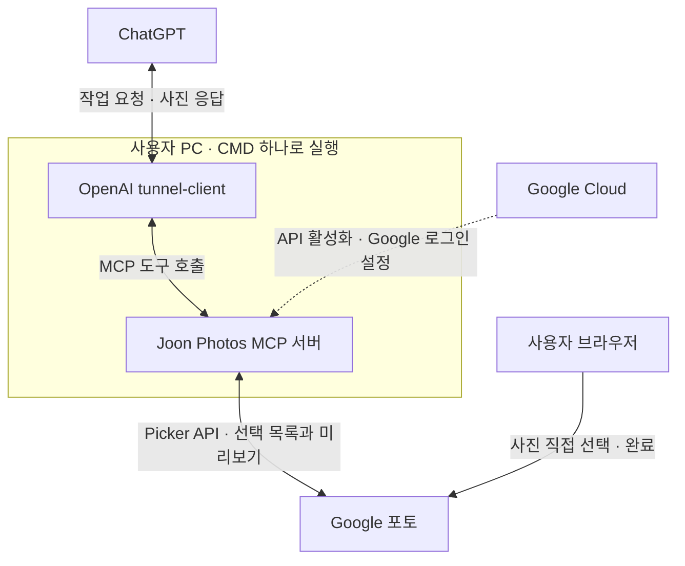

# Google 포토를 ChatGPT에 연결한 기록

> 환경: Windows PC · ChatGPT · Google Photos Picker API  
> 연결 및 사진 읽기 검증: 2026-10-12 / 정리: 2026-10-13

## 1. 목적과 접근 방식

Google 포토에 보관한 사진을 ChatGPT가 읽고, 사진 설명이나 블로그 작성에 활용하는 것이 목적이었다.

구축 당시 Google 포토에 바로 연결할 공식 MCP 서버를 찾을 수 없어, **공식 Google Photos Picker API를 호출하는 개인용 MCP 서버를 PC에 만들었다.** ChatGPT와 PC 서버는 **OpenAI 보안 터널**로 연결했다.

- **Google 포토:** 사진을 보관하고, 사용자가 선택한 사진을 API로 제공한다.[1]
- **PC의 MCP 서버:** ChatGPT의 요청을 받아 사진 선택창을 만들고, 선택한 사진의 미리보기를 전달한다.
- **OpenAI 보안 터널:** PC에서 OpenAI로 연결을 시작해 MCP 요청과 응답을 전달한다.[2]
- **ChatGPT:** 전달받은 사진을 보고 설명·정리·글 작성을 수행한다.

**접근 범위는 사용자가 직접 선택한 사진이다.** 전체 사진을 날짜로 자동 검색하는 기능은 이번 구성에 포함하지 않았다.

## 2. 전체 연결 구조



**실제 사용 흐름:** ChatGPT에 선택창 요청 → 링크에서 사진 선택 → 선택 완료 확인 → 사진 읽기 → 설명 또는 글 작성.

Google Cloud는 API와 로그인 권한을 설정하는 곳이다. 이번 MCP 서버는 사용자 PC에서 실행한다. 보안 터널을 사용하므로 PC 서버를 공개 인터넷 주소로 노출할 필요가 없다.[2]

## 3. 실제 진행한 절차

| 순서 | 수행 내용 | 결과 |
| --- | --- | --- |
| 1 | Windows에 Node.js 설치, `npm.cmd` 실행 확인 | JavaScript 서버 실행 환경 준비 |
| 2 | Google Cloud 프로젝트에서 Picker API 활성화, 외부·테스트 OAuth와 본인 테스트 사용자 설정 | Google 포토 접근 권한 준비 |
| 3 | 웹 애플리케이션 OAuth 클라이언트 생성, 인증 JSON을 PC의 `credentials.json`으로 보관 | Google 로그인 연결 준비 |
| 4 | 직접 만든 MCP 서버 패키지를 설치하고 `joon-photos.cmd` 실행 | 로그인 페이지와 사진 도구 서버 실행 |
| 5 | OpenAI에서 `Joon Photos MCP` 터널 생성, 본인 Personal 조직과 ChatGPT 워크스페이스 연결 | 터널 접근 대상 설정 |
| 6 | 공식 `tunnel-client` v0.0.16 설치, 런타임 API 키 생성 | 키는 `Restricted`에서 Tunnels의 **Read + Use**만 선택, 만료 90일 |
| 7 | `joon-photos` 프로필에 로컬 MCP 주소 등록, `doctor` 검사와 실제 터널 실행 | 관리 포트를 8081로 바꾼 뒤 검사 통과·Ready 확인 |
| 8 | ChatGPT에서 사용자 지정 MCP 서버 추가: 이름 `Joon Photos MCP`, 연결 **Tunnel**, 인증 **없음** | 플러그인 생성·연결, 실제 도구 호출 성공 |
| 9 | 로컬 화면에서 Google 로그인, Picker에서 사진 2장 선택 | ChatGPT가 두 이미지의 줄넘기 행사 장면을 실제로 읽고 설명 |
| 10 | 자동 실행 설정 적용, 기존 창 종료 후 CMD 하나로 재실행 | 터널 Ready와 Google 로그인 유지, MCP 응답 재확인 |

### 핵심 설정값

| 항목 | 이번 구성 |
| --- | --- |
| PC 설치 폴더 | `C:\code\joon_photos_mcp` |
| 반복 실행 파일 | `joon-photos.cmd` |
| Google 로그인 페이지 | `http://localhost:8080` |
| OAuth 리디렉션 URI | `http://localhost:8080/auth/google/callback` |
| Google 권한 범위 | `https://www.googleapis.com/auth/photospicker.mediaitems.readonly` |
| 로컬 MCP 주소 | `http://127.0.0.1:8787/mcp` |
| 터널 관리·상태 화면 | `http://127.0.0.1:8081/ui` |
| 터널 프로필 | `joon-photos` |

ChatGPT의 **인증 없음**은 PC MCP 서버 자체의 인증 방식이다. Google 로그인은 별도로 수행하고, 터널은 OpenAI 조직·워크스페이스 권한으로 접근을 제한한다.

## 4. 진행 중 해결한 문제

| 문제 | 처리 |
| --- | --- |
| PowerShell에서 `npm.ps1` 실행 정책 오류 | `npm.cmd`로 설치·실행 |
| 안내 경로와 실제 폴더명의 하이픈·밑줄 불일치 | 실제 경로 `C:\code\joon_photos_mcp`로 통일 |
| Google 로그인 서버와 터널 관리 화면의 8080 포트 충돌 | 터널 관리 포트를 **8081**로 변경하고 자동 실행에도 반영 |
| V3의 실행 파일 탐지 경고 | 사용자 파일과 공식 배포본의 SHA256 일치 확인. 탐지 원인은 미확인으로 남음 |

최종 검증은 **선택 사진 2장 읽기·설명·선택 세션 정리**와 **종료 후 재실행·도구 응답 확인**까지 완료했다.

## 5. 다음부터 사용하는 방법

1. PC에서 **`joon-photos.cmd`를 더블클릭**한다.
2. ChatGPT 입력창에서 **`@` → `Joon Photos MCP`**를 선택한다.
3. **“구글 포토에서 사진 선택창 열어줘.”**라고 요청한다.
4. 링크에서 사진을 고르고 완료한 뒤, 원하는 작업을 요청한다.
5. 작업 종료 시 실행 창에서 **Ctrl+C**를 누른다.

사용하는 동안 PC와 실행 창을 켜 둔다. 다음 실행 때 프로젝트·OAuth 클라이언트·터널을 다시 만들 필요는 없다.

- **Google 인증:** 현재 외부·테스트 설정에서는 갱신 토큰이 7일 후 만료되므로, 만료 시 로컬 로그인 페이지에서 다시 로그인한다.[4]
- **OpenAI 키:** 이번 키는 90일 만료로 설정했다. 만료 전에 새 키를 만들어 PC의 키 파일을 교체하고 실행을 다시 시작한다.

## 6. 다른 사람이 재현할 때

이 기록의 구조와 절차를 참고하되, **각자의 Google OAuth 클라이언트·OpenAI 터널·API 키**를 설정해야 한다. 서버 소스와 이번 자동 실행 패키지가 함께 있어야 실행할 수 있으며, 이 문서만으로 프로그램이 설치되지는 않는다.

GitHub에 서버 코드를 올릴 때는 아래 항목을 `.gitignore`에 포함한다.

```gitignore
credentials.json
.private/
node_modules/
```

인증 JSON·로그인 토큰·API 키는 공개하지 않는다. 이 문서에는 실제 비밀 키와 조직·워크스페이스·터널 식별자를 포함하지 않았다.

## 참고 자료

1. [Google Photos Picker API 시작 안내](https://developers.google.com/photos/picker/guides/get-started-picker)
2. [OpenAI Secure MCP Tunnel](https://developers.openai.com/api/docs/guides/secure-mcp-tunnels)
3. [ChatGPT 사용자 지정 MCP 서버 추가](https://developers.openai.com/api/docs/guides/custom-mcp-server)
4. [Google OAuth 2.0 · 갱신 토큰 만료](https://developers.google.com/identity/protocols/oauth2#expiration)
5. [OpenAI tunnel-client 공식 배포](https://github.com/openai/tunnel-client/releases)
