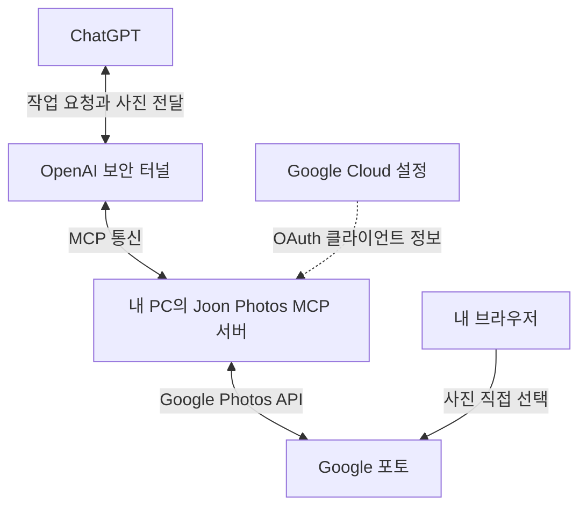

# Google 포토 ↔ ChatGPT MCP 연결 작업 기록과 재개 안내

> 작성 기준: 2026년 10월 12일, 한국 시간.  
> 현재 상태: Google 쪽 초기 설정, PC 서버 준비, OpenAI 터널 생성, 터널 프로그램 다운로드·해시 확인까지 진행. **ChatGPT 실제 연결과 사진 전달은 아직 완료되지 않음.**  
> 다음 시작 지점: **OpenAI 런타임 API 키 생성 화면을 열고 실제 권한 항목 확인.**

## 1. 무엇을 만들고 있는가

Google 포토에서 직접 선택한 사진을 ChatGPT에 전달해 사진 설명, 블로그 초안, 사진 정리 등의 작업에 사용하는 개인용 연결 환경을 만들고 있다.

한 번 초기 설정을 끝내면 다음부터는 PC에서 `joon-photos.cmd`를 실행하고, ChatGPT에서 사진 선택창을 열어 원하는 사진을 골라 작업한다. 매번 Google Cloud 프로젝트나 OpenAI 터널을 새로 만들 필요는 없다.

**가장 중요한 제한:** 이 구성은 Google Photos **Picker API**를 사용한다. ChatGPT가 Google 포토 전체를 자동으로 검색하는 방식이 아니다. 사용자가 선택창에서 직접 고른 사진을 읽는 방식이다. 최초 요청인 “2021년 1월 14일 사진 하나를 보고 설명하기”도 해당 날짜의 사진을 직접 선택한 다음 진행한다. [공식 근거: Picker 흐름][google-picker]

## 2. 현재 상태를 한눈에 보기

| 단계 | 현재 상태 | 기록 및 다음 확인 |
| --- | --- | --- |
| Node.js 설치 | 완료 | 사용자 PC에서 `v24.21.0` 확인 |
| npm 실행 확인 | 완료 | PowerShell에서는 `npm.cmd` 사용 |
| Google Photos Picker API 활성화 | 진행 완료 보고 | 기존 Google Cloud 프로젝트 사용 |
| Google OAuth 동의 화면 설정 | 진행 완료 보고 | 외부·테스트 방식으로 설정 절차 진행 |
| 테스트 사용자·Picker 권한 설정 | 절차 진행 | 재개 시 오류가 있으면 실제 등록값 재확인 |
| Google OAuth 웹 클라이언트·JSON 준비 | 진행 완료 보고 | 클라이언트 이름 `Joon Photos MCP`; 인증 파일은 PC에만 보관 |
| PC MCP 서버 패키지 설치·실행 | 완료 보고 | 새 패키지로 덮어쓰고 CMD 실행했다고 사용자 확인 |
| Google 실제 로그인 상태 | 재확인 필요 | 재개할 때 로컬 로그인 페이지와 도구 호출로 확인 |
| OpenAI 조직 확인 | 완료 | 조직 설정의 ID와 터널 창의 Organizations ID가 같음을 사용자 확인 |
| OpenAI 터널 생성 | 완료 | 이름 `Joon Photos MCP`; 본인 조직·ChatGPT 워크스페이스 선택 후 생성 |
| `tunnel-client` 설치 및 도움말 실행 | 완료 | Windows amd64, v0.0.16; `help quickstart` 결과 공유 |
| 실행 파일 SHA256 비교 | 완료 | 사용자 값이 공식 배포본과 정확히 일치 |
| AhnLab V3 탐지 사유 분석 | 미완료 | 사용자 1회 실행 허용; 진단명·탐지 상세는 아직 미확인 |
| OpenAI 런타임 API 키 생성 | 다음 작업 | 생성 화면·실제 권한 항목부터 확인 |
| 터널 프로필 초기화·연결 검사 | 미완료 | 프로필명 `joon-photos`를 사용할 예정 |
| 실행 파일에 터널 설정 저장 | 미완료 | `.private/tunnel.json` 작성 예정 |
| ChatGPT에 사용자 지정 MCP 등록 | 미완료 | 터널 실행 상태에서 등록·도구 조회 확인 |
| 실제 사진 선택·ChatGPT 설명 | 미완료 | 마지막 검증 단계 |

“완료 보고”는 대화에서 사용자가 진행했다고 알려준 상태이다. 사용자 PC의 실제 파일과 계정 로그인 상태를 원격으로 모두 검사한 것은 아니다.

## 3. 연결 구조와 각 서비스의 역할

아래는 **최종 연결을 마쳤을 때**의 구조이다. 현재는 보안 터널의 PC 연결과 ChatGPT 등록이 남아 있다.



| 구성 | 쉽게 설명하면 | 실제 역할 |
| --- | --- | --- |
| Google Cloud | Google 서비스 사용 허가를 설정하는 곳 | API 활성화, OAuth 클라이언트와 로그인 권한 설정 |
| Google 포토 | 사진이 있는 곳 | 사용자가 고른 사진과 미리보기 제공 |
| PC MCP 서버 | 사진 작업 요청을 처리하는 프로그램 | 선택창 생성, 선택 완료 확인, 사진 목록·미리보기 읽기 |
| MCP | 도구 호출에 사용하는 표준 통신 방식 | ChatGPT가 서버에 사진 관련 작업을 요청하는 형식 |
| `tunnel-client` | PC와 OpenAI를 연결하는 프로그램 | PC에서 OpenAI로 연결을 시작해 MCP 요청과 응답 전달 |
| ChatGPT | 사진을 해석하고 글을 만드는 곳 | 전달받은 미리보기로 설명·정리·초안 작성 |

현재 서버 코드는 **내 PC에서 실행**한다. Google Cloud에 서버를 배포한 것은 아니다. Google Cloud의 API·OAuth 설정과 OpenAI의 터널 등록은 PC 서버가 사용할 클라우드 설정이다. [공식 근거: 보안 터널][openai-tunnel]

Google 로그인 정보는 PC에 저장한다. 현재 구현은 사진 미리보기를 메모리에서 읽어 MCP 이미지 응답으로 전달하며, 사진 파일을 PC에 자동 보관하는 기능은 포함하지 않는다.

## 4. 실제 PC 경로와 파일

### 경로는 반드시 밑줄로 사용

사용자가 최종 확인한 실제 설치 폴더:

```text
C:\code\joon_photos_mcp
```

초기 안내의 `C:\code\joon-photos-mcp`는 실제 폴더명과 달랐다. **이 문서와 이후 사용자 명령은 밑줄 `_`이 있는 경로를 사용한다.** ZIP 내부 폴더나 기존 README의 예시 경로가 하이픈 `-`으로 되어 있어도 실제 설치 경로를 우선한다. 폴더 이름을 바꿀 필요는 없다.

| 파일 또는 폴더 | 역할 | 상태·주의 |
| --- | --- | --- |
| `joon_photos_mcp.zip` | 배포한 서버 패키지 | 초기 서버에 실행 도우미를 추가해 업데이트함 |
| `joon-photos.cmd` | 더블클릭 또는 한 줄 실행의 진입점 | 파일명에는 하이픈이 있음; 설치 폴더명과 구분 |
| `launcher.mjs` | 설치 확인·서버 시작·터널 시작을 묶음 | 실제 설치 폴더 기준으로 동작 |
| `server.mjs` | 로그인 웹 페이지와 MCP 도구 서버 | 8080·8787 포트 사용 |
| `google.mjs` | Google OAuth 및 Picker API 처리 | 로그인·토큰 갱신·선택 이미지 읽기 |
| `package.json` / `package-lock.json` | 필요 패키지 및 실행 명령 정의 | 최초 패키지 설치에 사용 |
| `node_modules` | 설치된 외부 코드 패키지 | 필요하면 최초 실행 시 자동 설치 |
| `credentials.json` | Google OAuth 웹 클라이언트 인증 정보 | PC에만 보관; 채팅·공개 저장소에 업로드 금지 |
| `.private/token.json` | Google 로그인 토큰 | 실제 로그인 완료 후 생성; 공유 금지 |
| `tunnel-client.exe` | OpenAI 보안 터널 실행 프로그램 | 다운로드·도움말·해시 확인 완료 |
| `tunnel.example.json` | 터널 자동 실행 설정의 형식 예시 | 실제 PC 경로로 수정해야 함 |
| `.private/tunnel.json` | 실행 도우미가 읽을 실제 터널 설정 | 앞으로 작성할 파일 |
| `.private/tunnel-api-key.txt` | OpenAI 런타임 키를 로컬 보관하는 예정 파일 | 앞으로 준비; 평문 파일이므로 공유·유출 주의 |

### 주소는 서로 역할이 다름

| 주소 | 용도 |
| --- | --- |
| `http://localhost:8080` | PC 브라우저에서 Google 로그인 상태 확인 |
| `http://localhost:8080/auth/google/callback` | Google OAuth 승인 후 돌아오는 등록된 리디렉션 URI |
| `http://127.0.0.1:8787/mcp` | 터널 프로그램이 연결할 로컬 MCP 서버 주소 |
| `http://127.0.0.1:8787/health` | 실행 도우미용 로컬 서버 상태 확인 |
| 터널 프로그램의 `/ui`, `/healthz`, `/readyz` | 터널 프로그램 자체의 관리·상태 화면; 실제 주소와 포트는 실행 출력에서 확인 |

로그인용 8080 주소와 MCP용 8787 주소를 바꾸어 넣지 않는다. ChatGPT에 사용자 PC의 `localhost` 주소를 직접 등록해 접속시키는 방식도 아니다.

## 5. 지금까지 설정한 Google 쪽 내용

Google 쪽에서 사용한 서비스는 **Google Cloud의 Google Photos API·OAuth**이다.

| 항목 | 설정 내용 |
| --- | --- |
| 프로젝트 | 기존 `My First Project`를 사용하도록 진행 |
| API | Google Photos Picker API |
| OAuth 사용자 유형 | 외부(External) |
| 운영 상태 | 테스트(Testing) 방식으로 진행 |
| 테스트 사용자 | 자신의 Google 이메일을 등록하는 절차 안내·진행 |
| 데이터 액세스 범위 | 아래 Picker 전용 scope |
| OAuth 클라이언트 유형 | 웹 애플리케이션(Web application) |
| OAuth 클라이언트 이름 | `Joon Photos MCP` |
| 승인된 JavaScript 원본 | 서버 측 OAuth 방식이므로 비워 두도록 안내 |
| 승인된 리디렉션 URI | `http://localhost:8080/auth/google/callback` |
| 인증 JSON 보관 | 실제 PC 폴더의 `credentials.json` |

Picker scope:

```text
https://www.googleapis.com/auth/photospicker.mediaitems.readonly
```

클라이언트 이름만 입력한 상태는 저장이 아니다. 최종 `만들기` 버튼으로 클라이언트를 생성하고 JSON을 다운로드하는 절차까지 안내했으며, 사용자가 진행했다고 응답했다. 실제 Google 로그인 성공은 재개 시 확인한다.

**외부·테스트 상태의 OAuth에는 주의할 점이 있다.** 현재 요청 scope는 단순 이름·이메일·프로필 scope가 아니므로, 발급된 갱신 토큰은 테스트 상태에서 7일 후 만료되는 정책의 적용 대상이다. 만료되면 같은 로컬 화면에서 다시 Google 로그인한다. 프로젝트나 OAuth 클라이언트를 다시 만들 필요는 없다. 운영 상태 전환은 아직 진행하지 않았다. [공식 근거: OAuth 갱신 토큰 만료][google-oauth]

## 6. 지금까지 설정한 OpenAI 쪽 내용

| 항목 | 확인 내용 |
| --- | --- |
| Platform 조직 | 화면에 `Personal` 표시 |
| 조직 ID | 조직 설정과 Create tunnel 창에 표시된 ID가 일치함을 사용자 확인 |
| 터널 이름 | `Joon Photos MCP` |
| 터널 설명 | `Personal Google Photos Picker MCP server running on my PC.` 입력 안내 |
| Organizations | 확인한 본인 조직 선택 |
| ChatGPT workspaces | 사용 중인 본인의 워크스페이스 선택하도록 안내 후 생성 완료 보고 |
| 생성 상태 | 사용자가 “만들었어”라고 확인 |
| 실제 터널 ID | 아직 대화에 제공되지 않음. 설정 페이지에서 `tunnel_…` 값을 확인해야 함 |
| 런타임 API 키 | 생성 안내 단계; 생성 완료 보고는 아직 없음 |

OpenAI의 **Organization**은 개발자 서비스의 관리 공간이고, **Project**는 그 안의 작업 단위이다. Google Cloud 프로젝트와도 서로 다른 개념이다.

화면에서 확인한 실제 이동 경로:

1. 처음 열린 화면은 `Project Settings → General`이었다.
2. 해당 화면 **오른쪽 위 `Organization settings ↗`** 버튼을 클릭한다.
3. 조직 설정의 `General`에서 이름과 `Organization ID`를 확인한다.
4. 터널 생성 창의 Organizations ID와 비교한다.

앞으로는 실제 보이는 화면을 기준으로 안내한다. 일반적인 Settings 링크만으로 프로젝트 화면과 조직 화면이 항상 같은 위치에 열리는 것은 아니다.

## 7. 터널 프로그램 다운로드·V3 경고·해시 확인 기록

| 항목 | 기록 |
| --- | --- |
| 공식 배포 경로 | OpenAI의 `openai/tunnel-client` GitHub Releases |
| 당시 다운로드 버전 | v0.0.16 |
| Windows 파일 | `tunnel-client-v0.0.16-windows-amd64.zip` |
| 실행 파일 | `C:\code\joon_photos_mcp\tunnel-client.exe` |
| 도움말 명령 | `help quickstart` |
| 사용자 실행 결과 | 상세 도움말 출력 확인 |
| AhnLab V3 | 실행 시 탐지 알림 발생, 사용자 1회 실행 허용 |
| SHA256 | 사용자 실행 파일의 값이 공식 배포본과 일치 |
| 미확인 사항 | V3 진단명, 정확한 탐지 대상·유형, 탐지 원인 |

실행 파일 확인에 사용한 실제 명령:

```powershell
(Get-FileHash "C:\code\joon_photos_mcp\tunnel-client.exe" -Algorithm SHA256).Hash
```

사용자가 보낸 값과 공식 v0.0.16 실행 파일의 값:

```text
4226BB74A72388147882881F29F79801B95E285D731A138071812E3AA6766571
```

검증 과정에서는 공식 ZIP을 배포 메타데이터의 체크섬과 비교하고, 그 안에 있는 실행 파일의 해시를 계산했다. **이 일치는 파일이 해당 공식 배포본과 같다는 뜻이다. V3 경고가 오탐이라는 판정이나 모든 보안 위험이 없다는 보증은 아니다.** 경고 원인은 여전히 미확인으로 기록한다. V3 예외 등록 또는 보호 해제를 권고한 것은 아니다.

이 해시는 **v0.0.16의 해당 Windows 실행 파일**에 한정된다. 다음 버전을 받을 경우 새 공식 배포본의 해시로 다시 비교해야 한다. 다운로드 링크는 최신 릴리스 페이지를 사용한다.

## 8. 검증한 서버 기능

| 기능·검사 | 결과 |
| --- | --- |
| Google OAuth 상태 일치·PKCE 검증 | 개발 환경 검사 통과 |
| 갱신 토큰 보존 및 액세스 토큰 갱신 | 개발 환경 검사 통과 |
| 선택 목록 페이지 처리 | 개발 환경 검사 통과 |
| 외부 이미지 주소로 Google 토큰 전송 차단 | 개발 환경 검사 통과 |
| 터널 설정 미등록 시 로컬 실행만 안내 | 개발 환경 검사 통과 |
| 터널 설정 읽기·프로필 이름 검증 | 개발 환경 검사 통과 |
| MCP 초기화·도구 목록 조회·로그인 전 요청 처리 | 개발 환경 통합 검사 통과 |
| 실행 도우미의 서버 시작·중복 실행 방지·종료 | 개발 환경 통합 검사 통과 |
| 실제 Google 계정 로그인과 사진 API 호출 | 사용자 환경에서 추가 확인 필요 |
| 실제 OpenAI 터널·ChatGPT 도구 호출 | 아직 미검증 |

서버가 제공하는 도구:

| MCP 도구 | 기능 |
| --- | --- |
| `photos_status` | 저장된 Google 로그인 정보 존재 여부 확인; 실제 토큰 유효성을 완전히 보증하는 검사는 아님 |
| `photos_create_picker` | 새 사진 선택 세션과 선택 링크 생성 |
| `photos_picker_status` | 사용자가 선택을 완료했는지 확인 |
| `photos_list_selected` | 해당 세션에서 선택한 사진 목록 조회 |
| `photos_read_image` | 선택 사진 미리보기를 MCP 이미지로 전달 |
| `photos_close_picker` | 작업이 끝난 선택 세션 정리; Google 포토 원본 사진 삭제 기능은 아님 |

## 9. 재개할 때 가장 먼저 할 일

**이 절은 앞으로 진행할 작업이다. 아직 실행 완료된 내용이 아니다.**

1. 필요하면 PC 서버를 다시 켠다.

   ```powershell
   & "C:\code\joon_photos_mcp\joon-photos.cmd"
   ```

2. PC 브라우저에서 `http://localhost:8080`을 열고 로그인 상태를 확인한다. 실제 API에서 인증 오류가 나면 다시 로그인한다.
3. [OpenAI Runtime API keys][runtime-keys] 페이지를 연다.
4. 터널을 만든 Personal 조직이 선택되어 있는지 확인한다.
5. 새 키 생성 창을 연다. 이름은 `Joon Photos Tunnel`로 사용할 예정이다.
6. **비밀 키가 나오기 전 생성 창의 항목을 기준으로 권한을 확인한다.** 실제 키 값은 채팅에 보내지 않는다.

터널 실행용 런타임 키와 그 주체에는 **Tunnels Read + Use** 권한이 필요하다. 터널 생성·수정의 **Read + Manage** 권한과 구분한다. 장시간 실행하는 터널 데몬에 Admin API 키를 주지 않는다. [공식 근거: 터널 권한][openai-tunnel]

확인할 미해결 항목:

- 실제 `tunnel_…` ID
- 런타임 키 생성 화면의 권한 항목과 생성 성공 여부
- Google 실제 로그인 및 API 호출 상태
- V3 탐지 기록의 진단명·파일 경로·처리 상태

## 10. 남은 연결 작업의 전체 순서

| 순서 | 앞으로 할 작업 | 완료 판단 기준 |
| --- | --- | --- |
| 1 | 런타임 키 생성·로컬 보관 | 올바른 조직·계정·터널 권한 확인 |
| 2 | 터널 ID 확인 | 생성한 `Joon Photos MCP`의 ID 확보 |
| 3 | HTTP 터널 프로필 초기화 | 로컬 MCP 주소와 ID가 정확히 저장됨 |
| 4 | `doctor --explain` 검사 | 연결·권한·MCP 관련 오류 확인 및 해결 |
| 5 | `.private/tunnel.json` 작성 | 실제 경로·프로필·키 보관 경로 입력 |
| 6 | 이전 서버 창 종료 후 CMD 재실행 | 서버와 터널이 함께 실행됨 |
| 7 | 터널 상태 확인 | healthy/ready 및 실제 MCP 통신 확인 |
| 8 | ChatGPT에 사용자 지정 MCP 등록 | 생성한 터널이 보이고 도구 조회 성공 |
| 9 | Google 포토에서 사진 선택 | 선택 링크에서 완료, 목록 읽기 성공 |
| 10 | ChatGPT에서 사진 설명 | 실제 이미지 응답을 받은 뒤 내용 설명 |

### 앞으로 사용할 초기화 명령의 예시

다음은 공유된 v0.0.16 도움말에 맞춘 **예정 명령**이다. 런타임 키 보관과 실제 권한 확인 후 진행한다. `tunnel_…` 값은 사용자가 생성한 터널 ID를 입력한다.

```powershell
cd C:\code\joon_photos_mcp
$photosTunnelId = Read-Host "생성한 tunnel_ ID를 입력하세요"
.\tunnel-client.exe init --sample sample_mcp_remote_no_auth --profile joon-photos --tunnel-id $photosTunnelId --mcp-server-url http://127.0.0.1:8787/mcp
```

런타임 키를 `.private/tunnel-api-key.txt`에 저장한 뒤 같은 PowerShell 세션에서 검사할 예정:

```powershell
$env:CONTROL_PLANE_API_KEY = (Get-Content "C:\code\joon_photos_mcp\.private\tunnel-api-key.txt" -Raw).Trim()
.\tunnel-client.exe doctor --profile joon-photos --explain
```

키를 명령줄에 직접 붙여 넣어 기록으로 남기는 방식 대신 로컬 파일에서 읽는 예시이다. 로컬 키 파일은 **평문**이므로 본인 PC에서만 보관한다. 현재는 이 파일을 준비하거나 위 명령을 실행한 것으로 확인되지 않았다.

### 앞으로 작성할 자동 실행 설정 예시

파일 위치:

```text
C:\code\joon_photos_mcp\.private\tunnel.json
```

예정 내용:

```json
{
  "executable": "C:\\code\\joon_photos_mcp\\tunnel-client.exe",
  "profile": "joon-photos",
  "apiKeyFile": ".private/tunnel-api-key.txt"
}
```

이 설정은 터널을 새로 만들지 않고, 이미 초기화한 프로필을 `run --profile joon-photos`로 실행한다.

**설정 파일을 추가한 후에는 기존 서버 CMD 창을 Ctrl+C로 종료하고 다시 실행해야 한다.** 서버가 이미 켜져 있으면 현재 실행 도우미는 중복 실행을 막고 종료하므로, 새 터널 설정을 자동 적용하지 않는다.

### 앞으로 ChatGPT에서 연결할 때

OpenAI 공식 안내의 사용자 지정 MCP 추가 화면에서 Connection의 **Tunnel**을 선택하고, 생성한 터널을 선택하거나 ID를 입력한다. 메뉴 이름·위치는 실제 계정 화면을 확인해 진행한다. 공식 문서에는 Plugins의 `+ → Add custom MCP server` 경로가 안내되어 있고, 설치된 프로그램 도움말에는 ChatGPT의 connector settings 경로도 안내되어 있다.

현재 PC 서버 자체에는 별도의 MCP OAuth 서버를 구현하지 않았다. **Google 로그인은 PC의 8080 화면에서 이미 수행하는 별도 과정**이다. 이 개인용 구성에서는 터널의 조직·워크스페이스 접근 제한을 이용한다. ChatGPT 등록 시 실제 인증 선택 항목을 확인한다.

터널 프로그램은 ChatGPT에 연결을 등록할 때와 이후 도구를 사용할 때 모두 실행 중이어야 한다. 단순히 프로그램이 시작되었다는 출력만으로 연결 성공을 판정하지 않는다. [공식 근거: 보안 터널][openai-tunnel]

## 11. 최종 완료 후 매번 사용하는 방법

**아래는 최초 연결 검증이 모두 끝난 뒤의 목표 사용 흐름이다. 현재 달성 여부는 위 상태표를 따른다.**

1. PC를 켜고 인터넷에 연결한다.
2. `joon-photos.cmd`를 더블클릭하거나 아래 한 줄을 실행한다.

   ```powershell
   & "C:\code\joon_photos_mcp\joon-photos.cmd"
   ```

3. 서버와 터널이 준비되었는지 확인한다. Google 인증이 만료된 경우 다시 로그인한다.
4. ChatGPT에서 연결한 `Joon Photos MCP` 도구를 사용해 선택창을 열어 달라고 요청한다.
5. 선택 링크에서 원하는 사진을 직접 선택하고 완료한다.
6. 사진 설명, 블로그 초안, 사진 비교 등 원하는 작업을 요청한다.
7. 사용이 끝나면 실행 창에서 Ctrl+C로 종료한다.

예시 요청:

> 구글 포토 선택창을 열어줘. 내가 선택한 사진을 보고 어떤 사진인지 설명해줘.

> 2021년 1월 14일 사진을 직접 선택할게. 선택한 사진 중 하나를 보고 설명해줘.

> 선택한 사진을 이용해 프라모델 제작기 블로그 초안을 작성해줘.

선택 사진 목록의 `createTime`은 UTC 시간이다. 날짜를 확인할 때 한국 시간 등 사용자의 시간대를 고려한다. 서버 재시작 후에는 기존 세션을 서버가 다시 사용하도록 구현하지 않았으므로 새로 사진을 선택한다.

## 12. 무엇이 남고, 무엇이 실행 중이어야 하는가

| 항목 | PC를 꺼도 남는가 | 다시 사용할 때 |
| --- | --- | --- |
| Google Cloud 프로젝트·API 활성화·OAuth 클라이언트 | 남음 | 일반적으로 재생성 불필요 |
| OpenAI 조직·터널 등록·연결 대상 | 남음 | 일반적으로 재생성 불필요 |
| ChatGPT 사용자 지정 MCP 등록 | 등록 완료 후에는 유지됨 | 연결을 삭제·해제하거나 정책이 바뀌면 재확인 |
| 서버 프로그램·설정 파일 | PC에서 삭제하지 않으면 남음 | 실행 파일 실행 |
| 로그인 토큰·런타임 키 | 파일은 남음 | 만료·취소되면 재로그인 또는 키 교체 필요 |
| 서버와 터널의 실제 프로세스 | 중단됨 | 다시 실행 필요 |
| 임시 사진 선택 세션 | 장기 보관 대상으로 사용하지 않음 | 작업 때 새로 선택 |

클라우드에 설정이 남아 있는 것과 실제 통신이 계속 실행되는 것은 다르다. PC가 꺼지거나 절전 상태에 들어가면 이 PC 서버를 통한 작업은 사용할 수 없다. 서버와 터널이 모두 실행되고 인증·접근 권한이 유효해야 한다.

## 13. 보안과 도용 가능성

동일한 설치 절차를 다른 사람이 따라 한다는 이유만으로 사용자 사진에 접근 권한이 생기지는 않는다. 그 사람은 자신의 Google 계정, OpenAI 조직·권한으로 설정하게 된다. 조직 ID와 터널 ID만 아는 것으로도 접속 권한이 생기지 않는다.

하지만 다음 경계는 명확히 관리해야 한다.

| 대상 | 주요 사항 |
| --- | --- |
| Google·OpenAI 계정 | 계정 탈취 또는 승인하지 않은 로그인 주의 |
| Google 토큰·OpenAI 런타임 키 | 복사·유출되면 부여된 권한 범위에서 악용될 수 있음 |
| 조직·워크스페이스 | 이 터널을 사용할 권한을 가진 다른 구성원이 있으면 개인 전용이라고 단정할 수 없음 |
| PC 내부 | 현재 로컬 MCP 서버에는 별도 사용자 인증이 없어, 같은 PC의 다른 사용자·프로그램이 요청할 수 있음 |
| 인터넷 노출 | 현재 서버는 `127.0.0.1`에 바인딩; 인증 없는 공개 URL로 바꾸어 노출하지 않음 |
| 저장 방식 | 인증 정보는 로컬 파일에 보관; 현재 패키지에 별도의 암호화 저장 기능은 없음 |

공유하지 않을 대상:

- `credentials.json`
- `.private/token.json`
- `.private/tunnel-api-key.txt` 및 실제 API 키 값
- 인증 정보가 들어 있는 `.private` 폴더 전체

서버 소스 ZIP에는 사용자 인증 정보가 들어 있지 않다. Google 앱의 API 사용 scope가 있다고 해서 계정 전체 라이브러리를 자동 검색할 수 있는 것은 아니며, Picker에서 선택한 사진을 읽는 구조이다. [공식 근거: Picker 흐름][google-picker]

연결을 정리할 때는 역할을 구분한다. 서버 종료는 실시간 연결을 멈추는 조치이고, Google 권한 취소와 OpenAI 키 폐기·터널/ChatGPT 연결 제거는 해당 접근을 해제하는 조치이다. 단순한 작업 중단을 위해 클라우드 설정을 삭제할 필요는 없다.

## 14. 자주 발생한 문제와 해결 기록

| 증상 | 확인할 원인 | 이번 작업에서의 대응 |
| --- | --- | --- |
| `node`를 찾을 수 없음 | Node.js 설치 또는 PATH | Node 설치 후 버전 확인 완료 |
| `npm.ps1` 실행 정책 오류 | PowerShell 스크립트 정책 | `npm.cmd`로 실행; 정책 변경 없이 진행 |
| Settings에서 기대한 메뉴가 안 보임 | 프로젝트 설정과 조직 설정 혼동 | Project Settings 오른쪽 위 Organization settings 버튼 사용 |
| OAuth 클라이언트 이름 입력 후 저장 여부 혼동 | 이름 입력만으로 생성되지 않음 | 리디렉션 URI 입력 후 만들기 버튼 안내 |
| 실행 파일 경로를 찾을 수 없음 | 설치 폴더의 `_`와 안내한 `-` 불일치 | 실제 `C:\code\joon_photos_mcp` 경로로 수정 |
| V3 탐지 경고 | 진단명·대상·평판·행위 정보 확인 필요 | 공식 파일과 해시 일치 확인, 탐지 원인은 미확인 |
| Google 인증 오류 | 테스트 토큰 만료, scope, 테스트 사용자, URI | 8080 로그인 페이지에서 재로그인·Cloud 설정 확인 |
| 서버 포트 사용 중 오류 | 이미 실행 중인 서버가 있음 | 기존 창 Ctrl+C 종료 후 한 개 실행 |
| 터널이 ChatGPT에 안 보임 | 조직·워크스페이스 연결 또는 Use 권한 | 생성한 터널의 연결 대상과 권한 재확인 |
| 서버는 켜졌지만 ChatGPT 도구 호출 실패 | 터널 미실행·인증 오류·MCP 연결 오류 | doctor, 터널 상태, 실제 도구 조회로 확인 |
| 선택 완료 전 사진 목록 오류 | 사용자가 Picker 완료를 누르지 않음 | 선택 완료 상태를 확인한 뒤 목록 조회 |

### 명령어 의미

| 명령 | 뜻 |
| --- | --- |
| `node --version` | JavaScript 실행 프로그램인 Node 버전 확인 |
| `npm.cmd --version` | npm 버전 확인 |
| `npm.cmd install` | 프로젝트에 필요한 외부 코드 패키지 설치 |
| `npm.cmd start` | 이 패키지에서는 `node server.mjs`를 실행 |
| `joon-photos.cmd` | 설치 상태 확인, 서버 실행, 로그인 페이지 열기, 저장된 터널 설정이 있으면 터널 실행 |
| `tunnel-client.exe help quickstart` | 설치된 버전의 공식 시작 안내 출력 |
| `Get-FileHash ... -Algorithm SHA256` | 파일 실행 없이 해시 계산 |
| `doctor --profile joon-photos --explain` | 해당 터널 설정의 연결·권한·대상 문제 진단 |

## 15. 최종 완료 체크리스트

- [x] Node·npm 실행 확인
- [x] Google Cloud 설정 절차 진행 및 서버 패키지 준비
- [x] 사용자 PC에서 새 CMD 실행 보고
- [x] OpenAI 조직 ID 확인
- [x] 본인 조직·ChatGPT 워크스페이스로 터널 생성 보고
- [x] 터널 프로그램 도움말 확인
- [x] 공식 v0.0.16 실행 파일과 사용자 SHA256 일치 확인
- [ ] Google 실제 로그인·Picker API 호출 성공 확인
- [ ] 런타임 API 키 생성 및 Read + Use 권한 확인
- [ ] 터널 ID를 실제 프로필에 적용
- [ ] doctor 검사에서 필요한 연결 조건 확인
- [ ] 서버·터널 자동 실행 설정 저장
- [ ] 실제 터널 healthy/ready 및 MCP 통신 확인
- [ ] ChatGPT 사용자 지정 MCP 등록·도구 조회 성공
- [ ] 사용자 사진 선택·목록 확인 성공
- [ ] 실제 사진 미리보기 전달·설명 성공
- [ ] PC에서 종료 후 재실행해 반복 사용 확인
- [ ] V3 탐지 사유와 처리 상태 확인

“실행 창이 켜짐”, “해시가 일치함”, “클라우드 터널을 생성함” 각각을 전체 연결 완료로 판정하지 않는다. 최종 결과는 **ChatGPT가 직접 선택한 실제 사진을 보고 설명하는 것**과 **다음 실행에서도 같은 흐름을 재사용하는 것**이다.

## 16. 나중에 이어서 요청할 문구

같은 대화에서:

> Google 포토 MCP 연결 작업 계속하자. 런타임 API 키 생성부터 이어서 진행해줘.

새 대화에서는 이 MD 파일을 함께 제공하고:

> 첨부한 작업 기록을 기준으로 Google 포토 MCP 연결을 이어서 진행해줘. 내 PC 경로는 C:\code\joon_photos_mcp야. 터널 생성과 공식 실행 파일 해시 확인까지 완료했고, 런타임 API 키 생성부터 남아 있어. 실제 화면을 확인하며 한 단계씩 안내해줘.

작업을 쉬는 동안 실행 창을 종료해도 클라우드에 만든 설정은 유지된다. 현재 실행 중인지 여부는 재개 시 확인한다. 별도의 예약 실행이나 알림은 설정하지 않았다.

## 17. 공식 참고 주소

- [Google Photos Picker 시작 안내][google-picker]
- [Google OAuth 설정 안내](https://developers.google.com/photos/overview/configure-your-app)
- [Google OAuth 갱신 토큰 만료 정책][google-oauth]
- [OpenAI Secure MCP Tunnel][openai-tunnel]
- [OpenAI 터널 관리](https://platform.openai.com/settings/organization/tunnels)
- [OpenAI 런타임 API 키][runtime-keys]
- [OpenAI 사용자 지정 MCP 등록](https://developers.openai.com/api/docs/guides/custom-mcp-server)
- [OpenAI tunnel-client 최신 공식 배포](https://github.com/openai/tunnel-client/releases/latest)
- [AhnLab V3 파일 분석 보고서 안내](https://help.ahnlab.com/V3_365_4/ko_kr/v3_report.htm)

[google-picker]: https://developers.google.com/photos/picker/guides/get-started-picker
[google-oauth]: https://developers.google.com/identity/protocols/oauth2
[openai-tunnel]: https://developers.openai.com/api/docs/guides/secure-mcp-tunnels
[runtime-keys]: https://platform.openai.com/settings/organization/api-keys
